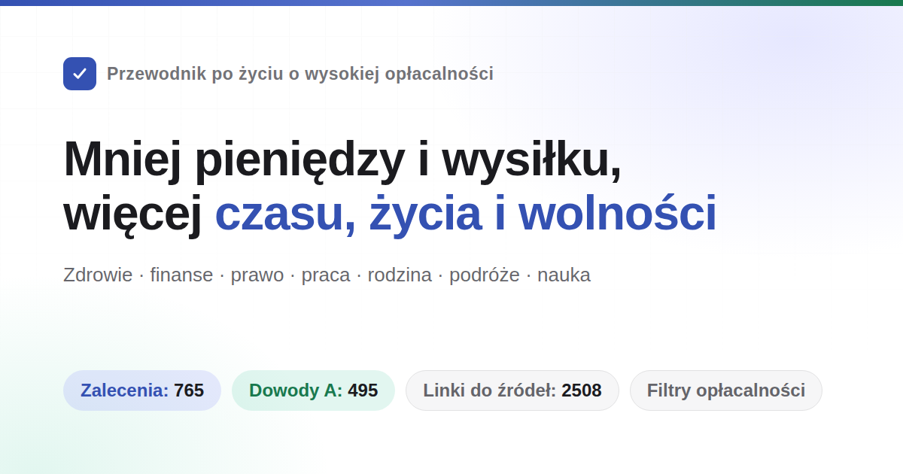

<div align="center">



# Przewodnik po życiu o wysokiej relacji korzyści do kosztów

Dowiesz się, jak żyć dłużej i rzadziej chorować, a także jak pomagać w nagłych wypadkach. Książka podpowiada, jak nie przepłacać i jak unikać oszustw oraz kłopotów z prawem. Wyjaśnia, jakie świadczenia można uzyskać po utracie pracy lub pieniędzy oraz jakie formalności wiążą się z prowadzeniem sklepu, firmy czy strony internetowej. Porusza też tematy związków, małżeństwa, dzieci, wyjazdów za granicę i nauki zawodu. Informacje o prawie, ubezpieczeniu zdrowotnym i społecznym opierają się na aktualnych przepisach Chin kontynentalnych.<br>
765 zaleceń. Przy każdym podano koszty, możliwe korzyści i siłę dowodów. Źródła to wyłącznie artykuły naukowe i dokumenty urzędowe. W kilku sprawach nieujawnionych oficjalnie wykorzystano podpisane, oryginalne materiały dziennikarskie z archiwalnymi kopiami stron.

Nie musisz robić wszystkiego. To lista możliwości, a nie lista zadań. Wybierz jedną lub dwie rzeczy. Autor sam nie wdrożył większości zaleceń.

Informacje w książce mogą się zdezaktualizować lub zawierać błędy. Wiele zasad jest różnie stosowanych w poszczególnych miejscach. Załatwiając sprawy urzędowe, lecząc się lub prowadząc sprawę sądową, kieruj się informacjami od właściwych lokalnych urzędów, lekarzy i prawników. Jeśli zauważysz błąd, [zgłoś problem](https://github.com/eternity4719/HowToLiveBetter/issues).

**Ten projekt nigdy nie wyemitował i nie wyemituje żadnych tokenów ani aktywów cyfrowych.** Żadne tokeny wydane pod nazwą projektu nie mają z nim związku. Autor nie otrzymuje ani nie rości sobie prawa do żadnych związanych z nimi zysków. Traktuj takie tokeny jak oszustwo i ich nie kupuj. Zob. [sekcja 5, punkt 45 (nie kupuj kryptowalut)](book/05-不要浪费钱.md).

[](https://eternity4719.github.io/HowToLiveBetter/)
[](#目录)
[](#证据分级)
[](docs/核实记录/)
[](#许可)
[](https://claude.com/claude-code)

### [Otwórz wyszukiwarkę online](https://eternity4719.github.io/HowToLiveBetter/) · [AI odpowiadająca na podstawie książki (skill)](skills/life-decision-guide/README.md)

Skill dla asystenta AI działa z Claude Code i Codex. Po instalacji możesz zapytać na przykład: „替朋友担保签不签” („czy poręczyć pożyczkę przyjacielowi?”). Asystent najpierw wyszuka odpowiednie punkty w książce, a potem odpowie, podając sekcję i numer punktu.

<table>
<tr><td align="right"><b>下载</b></td><td align="left">

[PDF](https://github.com/eternity4719/HowToLiveBetter/releases/download/epub-latest/HowToLiveBetter.pdf) · [EPUB](https://github.com/eternity4719/HowToLiveBetter/releases/download/epub-latest/HowToLiveBetter.epub) · [Pojedynczy plik offline (HTML)](https://github.com/eternity4719/HowToLiveBetter/releases/download/epub-latest/HowToLiveBetter.html) · [Talia Anki](https://github.com/eternity4719/HowToLiveBetter/releases/download/epub-latest/HowToLiveBetter.apkg)

</td></tr>
<tr><td align="right"><b>查阅</b></td><td align="left">

[Spis treści](#目录) · [Słowniczek](#读懂数字术语表) · [Dokumentacja weryfikacji](docs/核实记录/)

</td></tr>
<tr><td align="right"><b>自查</b></td><td align="left">

[Samoocena](https://eternity4719.github.io/HowToLiveBetter/selfcheck.html): odpowiedz na kilkadziesiąt pytań „tak/nie” i sprawdź, których zaleceń jeszcze nie wdrożyłeś oraz od czego zacząć

</td></tr>
<tr><td align="right"><b>长文</b></td><td align="left">

[Czy małżeństwo się opłaca](docs/结婚划不划算.md) · [Rodzinny zestaw awaryjny](docs/家庭应急装备清单.md) · [Czy zatrzymać się, gdy obcemu przydarzy się wypadek](docs/遇到陌生人出事该不该停.md) · [Jakie zezwolenia są potrzebne do prowadzenia platformy](docs/做平台要办哪些证.md) · [Zegar biologiczny i praca nocna](docs/生物钟和夜班.md) · [Co zrobić po zwolnieniu](docs/被裁了之后先做什么.md) · [Sprawy do załatwienia przed narodzinami dziecka i po nich](docs/孩子出生前后要办的事.md) · [Co robić po rozpoznaniu choroby przewlekłej](docs/刚确诊慢性病之后.md) · [Przed zmianą pracy lub miasta](docs/换工作、换城市之前.md)

</td></tr>
<tr><td align="right"><b>交流</b></td><td align="left">

[Grupa QQ 582670354](https://qm.qq.com/q/P1RNw3Rnqg) (kliknij, aby dołączyć)

</td></tr>
<tr><td align="right"><b>其他语言</b></td><td align="left">

[English](https://book.dlgrv.com/en/) · [Русский](https://book.dlgrv.com/ru/) · [Español](https://book.dlgrv.com/es/) · [Português](https://book.dlgrv.com/pt/) · [العربية](https://book.dlgrv.com/ar/) · [Bahasa Indonesia](https://book.dlgrv.com/id/)，tłumaczenia utrzymywane przez [dlgrv](https://github.com/dlgrv) ([repozytorium](https://github.com/dlgrv/HowToLiveBetter))

[English（The Evidence-Based Life）](https://parveen0029.github.io/The-Evidence-Based-Life/)，drugie tłumaczenie angielskie utrzymywane przez [parveen0029](https://github.com/parveen0029) ([repozytorium](https://github.com/parveen0029/The-Evidence-Based-Life))

[Tiếng Việt](https://chuanman2707.github.io/HowToLiveBetter/)，tłumaczenie wietnamskie utrzymywane przez [chuanman2707](https://github.com/chuanman2707) ([repozytorium](https://github.com/chuanman2707/HowToLiveBetter))

</td></tr>
<tr><td align="right"><b>衍生工具</b></td><td align="left">

Strony internetowe, aplikacje, miniaplikacje, dodatki do przeglądarek i zbiory danych przygotowane przez czytelników opisano w dokumencie [Projekty pochodne](衍生项目.md).

</td></tr>
</table>

<sub>Inne wersje językowe i narzędzia pochodne są utrzymywane przez inne osoby i mogą być nieaktualne. W razie rozbieżności obowiązuje chiński tekst źródłowy w tym repozytorium.</sub>

</div>

---

## 这本书想回答的问题

| Pytanie | Gdzie szukać |
| --- | --- |
| Co można zrobić niemal bez kosztów, by wyraźnie zmniejszyć ryzyko przedwczesnej śmierci? | [1. Unikaj przedwczesnej śmierci](book/01-不要早死.md) |
| Jak bardzo skracają życie palenie, alkohol, siedzący tryb życia i zarwane noce? Jak rzucić palenie i picie oraz jak wybierać i używać oleju do gotowania? | [2. Nie umieraj powoli](book/02-不要慢慢死.md) |
| Co zrobić, gdy codziennie brakuje ci energii i ciągle ktoś ci przerywa? | [3. Nie marnuj energii](book/03-不要浪费精力.md) |
| Na co tracisz czas, jak ograniczyć bezcelowe zajęcia i jak radzić sobie z prokrastynacją? | [4. Nie marnuj czasu](book/04-不要浪费时间.md) |
| Jak przechowywać oszczędności, by nie pochłonęły ich odsetki, opłaty i oszustwa? Jak uniknąć problemów przy zakupie samochodu? | [5. Nie marnuj pieniędzy](book/05-不要浪费钱.md) |
| Z jakich suplementów i pakietów badań można zrezygnować bez żalu? | [6. Czego nie warto robić](book/06-反面清单.md) |
| Co przysługuje po utracie pracy, zaległościach z wypłatą lub braku pieniędzy i gdzie szukać pomocy? | [7. Jak przetrwać bez pieniędzy](book/07-没钱的时候怎么活.md) |
| Do kogo należą posag, mieszkanie kupione przed ślubem i duże przelewy w związku? Co zrobić po oskarżeniu lub fałszywym zawiadomieniu? O ile może zmniejszyć karę dobrowolne zgłoszenie się po popełnieniu przestępstwa? Czy później można dochodzić odpowiedzialności i odszkodowania? | [8. Prawo i bezpieczeństwo majątku](book/08-别把自己搭进去.md) |
| Które „dorywcze prace” i drobne przysługi mogą sprawić, że zwykła osoba stanie się oskarżonym w sprawie karnej? | [9. Pułapki prawne dla zwykłych ludzi](book/09-普通人容易踩的法律红线.md) |
| Czy lepiej poznawać wiele osób, czy zabiegać o jedną? Czy związek na odległość ma szanse? Co zabrać do urzędu, by zarejestrować małżeństwo? Czy samo wesele bez rejestracji czyni z pary małżeństwo? | [10. Czy związek i małżeństwo się opłacają](book/10-恋爱和结婚划不划算.md) |
| Za jakie programy i zlecenia można trafić do więzienia? | [11. Pułapki prawne dla programistów i osób z branży technicznej](book/11-程序员和技术人容易踩的红线.md) |
| Co trzeba przemyśleć przed pożyczeniem pieniędzy na sklep lub założeniem firmy? | [12. Przedsiębiorczość i prowadzenie firmy](book/12-创业与做生意.md) |
| Co zrobić najpierw, gdy ktoś stracił przytomność, mocno krwawi, wybuchł pożar albo ktoś się zgubił? | [13. Nagłe sytuacje: co zrobić najpierw](book/13-紧急情况.md) |
| Co zrobić najpierw po przejęciu konta lub zgubieniu telefonu? | [14. Bezpieczeństwo kont i informacji](book/14-账号与信息安全.md) |
| Co zrobić, gdy zatrzymano kaucję, właściciel każe się wyprowadzić lub upadła firma wynajmująca mieszkania? Na jakie konto wpłacić pieniądze za mieszkanie w budowie, co zrobić z opóźnionym odbiorem i czy można negocjować niższe oprocentowanie kredytu? Czy można kupić dom na wsi po przeprowadzce? | [15. Wynajem i zakup mieszkania](book/15-租房与买房.md) |
| Jak długofalowo leczyć chorobę przewlekłą i ograniczyć wydatki po diagnozie? | [16. Jak żyć z chorobą przewlekłą](book/16-得了慢性病之后怎么活.md) |
| Jak wcześniej uregulować opiekę, testament i finanse starszej osoby? | [17. Starsza osoba w rodzinie](book/17-家里有老人.md) |
| Jakie świadczenia przysługują po urodzeniu dziecka i ile czasu oraz pieniędzy wymaga jego wychowanie? | [18. Czy opłaca się mieć dzieci](book/18-养孩子划不划算.md) |
| Jak obliczyć nadgodziny, urlop wypoczynkowy i odprawę po zwolnieniu? Jak uznać wypadek przy pracy i uzyskać świadczenia? | [19. Praca, odejście z pracy i wypadki przy pracy](book/19-在职离职和工伤.md) |
| Co jest najważniejsze w pierwszych dniach życia dziecka? | [20. Opieka nad noworodkiem](book/20-刚出生的孩子怎么带.md) |
| Do których krajów lepiej teraz nie jechać i w jakim zakresie pomoże konsulat po wypadku? | [21. Wyjazdy, podróże i bezpieczeństwo za granicą](book/21-出国旅行与境外安全.md) |
| Jak uniknąć problemów w KTV, kafejce internetowej lub escape roomie? Co najlepiej pomaga na stres? | [22. Odpoczynek: rozrywka i redukcja stresu](book/22-怎么放松.md) |
| Czy opłaca się uczyć spawania, angielskiego lub zdobywać certyfikat? Jak uczyć się szybciej, gdzie składać wniosek o tytuł zawodowy i czy warto kontynuować naukę na studiach magisterskich lub doktoranckich? | [23. Jakich umiejętności warto się uczyć](book/23-学什么技能划算.md) |
| Ile kosztuje leczenie tej samej choroby w przychodni i szpitalu trzeciego stopnia? Gdzie zgłosić się po ciężkim urazie? Czy po leczeniu trzeba uzyskać orzeczenie o niepełnosprawności? Ile kosztuje implant zęba i czy pokrywa go ubezpieczenie zdrowotne? | [24. Leczenie: jak ograniczyć koszty i niepotrzebne wizyty](book/24-看病.md) |
| Co zrobić po śmierci członka rodziny, jakie pieniądze można odzyskać i z jakich opłat można zrezygnować? | [25. Formalności po śmierci bliskiej osoby](book/25-人走了以后要办什么.md) |
| Jakie zezwolenia są potrzebne do zarabiania na stronie lub platformie i gdzie umieścić serwer? | [26. Strona lub platforma: zezwolenia, rejestracja i serwer](book/26-做一个网站或平台.md) |
| Co robić na poszczególnych etapach ciąży i porodu oraz jakie dokumenty załatwić przed wyjściem ze szpitala? | [27. Ciąża i poród: od potwierdzenia ciąży do formalności po porodzie](book/27-怀孕和生产.md) |
| Które metody odchudzania, poprawiania wyglądu i prostowania zębów mogą zaszkodzić? | [28. Nie niszcz zdrowia dla wyglądu](book/28-别为了外形把身体搞坏.md) |
| Co jest najważniejsze w pierwszych miesiącach po śmierci bliskiej osoby, zwolnieniu lub diagnozie ciężkiej choroby? | [29. Po poważnym kryzysie](book/29-遭遇重大打击之后.md) |
| Których problemów zdrowotnych i psychicznych dziecka w wieku szkolnym nie należy odkładać do końca egzaminów? | [30. Dzieci w wieku szkolnym](book/30-上学以后的孩子.md) |
| Jakie drogi są dostępne po ukończeniu 18 lat poza nauką i pracą oraz jakie są ich wymagania? | [31. Jakie możliwości są po ukończeniu 18 lat](book/31-十八岁之后有哪几条路.md) |
| Jak zachować status pobytowy podczas studiów za granicą i czy dyplom zostanie uznany po powrocie? | [32. Studia za granicą: status, praca, ubezpieczenie i uznanie dyplomu](book/32-出国留学.md) |
| Co zrobić, gdy ty lub członek rodziny stanie się osobą z niepełnosprawnością? Jakie powikłania ograniczać, o jakie świadczenia się ubiegać i jak rozwiązać kwestie nauki, pracy oraz opieki? | [33. Życie z niepełnosprawnością](book/33-残疾之后怎么活.md) |
| Których leków na przeziębienie, gorączkę i żołądek nie łączyć? Czego unikać u dzieci, kobiet w ciąży i osób starszych? | [34. Domowe leki: jak uniknąć błędów](book/34-家里的常备药别吃出事.md) |

## 怎么读

- **Nie musisz wdrażać wszystkiego**: to lista możliwości, nie zadań. Wybierz jedną lub dwie rzeczy, a do pozostałych wróć w razie potrzeby. Słusznie mówi się, że łatwiej coś powiedzieć, niż zrobić — autor również nie wdrożył większości zaleceń. Zapisał je, by można je było znaleźć, gdy będą potrzebne. Jeśli chcesz wybrać łatwiejsze działania, przejdź do punktu „Chcę zobaczyć tylko to, co najbardziej się opłaca”.
- **Chcesz, by AI wyszukała informacje**: repozytorium zawiera chiński skill ([skills/life-decision-guide](skills/life-decision-guide/)), który można zainstalować w Claude Code i Codex. Po instalacji możesz zapytać na przykład: „替朋友担保签不签” („czy poręczyć pożyczkę przyjacielowi?”) albo „每天通勤两小时值不值” („czy warto codziennie dojeżdżać do pracy przez dwie godziny?”). Asystent wyszuka odpowiednie punkty w tekście, odpowie zgodnie z zasadami książki i poda sekcję oraz numer punktu. Jeśli niczego nie znajdzie, powie o tym zamiast wymyślać liczby. Instrukcja instalacji znajduje się w [dokumentacji tego katalogu](skills/life-decision-guide/README.md).
- **Chcesz wybierać według kryteriów**: otwórz [wyszukiwarkę online](https://eternity4719.github.io/HowToLiveBetter/). Możesz filtrować według słów kluczowych, sekcji i poziomu dowodów, a także według tego, czy coś kosztuje pieniądze, ile zajmuje czasu i czy wymaga wytrwałości. Filtry można łączyć. Treść strony pochodzi bezpośrednio z plików w katalogu book/ i zmienia się wraz z nimi.
- **Punkty odsyłają do siebie nawzajem** (na przykład „zob. sekcja 8, punkt 17”): w wyszukiwarce odsyłacz jest oznaczony przerywaną linią. Kliknij go, by zobaczyć tytuł i przystępne wyjaśnienie wskazanego punktu. Aby przejść do niego w tekście, kliknij „Przejdź”. Jeśli filtry ukrywają ten punkt, strona automatycznie je wyłączy. W GitHubie odsyłacze w tekście nie są klikalne, ale każdy zawiera opis celu (na przykład „zob. punkt 18 (spisz pożyczkę)”), więc wiadomo, o który punkt chodzi.
- **Chcesz czytać po kolei**: kolejność punktów w sekcji nie oznacza, że wcześniejsze bardziej się opłacają. Na początku dłuższych sekcji znajduje się tematyczny przewodnik, który ułatwia wybór.
- **Chcesz czytać offline lub wysłać książkę komuś**: pobierz [pojedynczy plik HTML offline](https://github.com/eternity4719/HowToLiveBetter/releases/download/epub-latest/HowToLiveBetter.html). Zawiera całą książkę, wyszukiwarkę i filtry. Otwiera się dwukrotnym kliknięciem, bez serwera i internetu; można go też przesłać przez WeChat.
- **Chcesz wydrukować książkę lub czytać ją na telefonie**: pobierz [PDF](https://github.com/eternity4719/HowToLiveBetter/releases/download/epub-latest/HowToLiveBetter.pdf). Ma format A4, ponad 200 stron, spis treści z numerami stron i zakładki. Każda sekcja zaczyna się na nowej stronie.
- **Chcesz czytać na Kindle lub innym czytniku**: pobierz [e-book EPUB](https://github.com/eternity4719/HowToLiveBetter/releases/download/epub-latest/HowToLiveBetter.epub). Na Kindle możesz wysłać go przez Send to Kindle.
- **Chcesz zapamiętać treść i wracać do niej po kilku dniach**: pobierz [talię Anki](https://github.com/eternity4719/HowToLiveBetter/releases/download/epub-latest/HowToLiveBetter.apkg) i otwórz ją w Anki. Każdy punkt ma jedną kartę, a karty są podzielone na podtalie według sekcji. Na awersie jest zalecenie, a na rewersie przystępne wyjaśnienie, koszty i poziom dowodów. Możesz uczyć się tylko wybranych sekcji lub filtrować karty według etykiet, takich jak „bardzo opłacalne”. Po ponownym pobraniu i zaimportowaniu talia zaktualizuje treść, nie usuwając historii powtórek.
- **Wszystkie cztery wersje są automatycznie generowane po każdej zmianie tekstu głównego**. Linki do pobierania pozostają takie same, ale przesłany komuś plik nie aktualizuje się. Korzystaj z wersji online, by mieć aktualną treść.
- **Nie rozumiesz liczb**: każdy punkt zawiera przystępne wyjaśnienie. Przekłada ono zapisy z pola „Korzyści” na codzienny język, na przykład „ryzyko zgonu w tym okresie jest niższe o około jedną piątą” lub „kilka dni aresztu i określona grzywna”. Nie dodaje informacji ani liczb, których nie ma w polu „Korzyści”. Do podjęcia decyzji wystarczy samo wyjaśnienie. Wszystkie liczby pozostają w polu „Korzyści”, gdzie można je samodzielnie sprawdzić.
- **Chcesz zobaczyć tylko najlepiej udokumentowane wnioski**: zaznacz poziom dowodów A w wyszukiwarce. Zostanie 495 punktów z konkretnymi liczbami pochodzącymi z metaanaliz lub dużych badań.
- **Chcesz zobaczyć tylko to, co najbardziej się opłaca**: wybierz filtr „bardzo opłacalne”. Zostanie 122 punktów, które nic nie kosztują, zajmują mało czasu, nie wymagają wytrwałości i przynoszą korzyść z najwyższej kategorii. Dodaj filtr „co zyskujesz”, by zobaczyć priorytety w wybranej kategorii.
- **Nie martw się, gdy tytuł sekcji zaczyna się od słowa „Nie”**: opisuje on problem, któremu sekcja ma zapobiegać (na przykład przedwczesnej śmierci lub marnowaniu czasu), a nie oznacza, że każdy punkt nakazuje czegoś zaniechać. Konkretne działania opisują tytuły punktów. Zaczynają się od czasownika i jasno wskazują, co zrobić albo czego nie robić. W sekcji 4 są zarówno zalecenie „zapisz zamiar w formie: kiedy, gdzie i co ma się wydarzyć”, jak i „nie oglądaj telewizji ani wiadomości podawanych w trybie ciągłym”. Czytaj tytuły punktów, a nie dopasowuj ich do tonu tytułu sekcji.

Każde zalecenie wygląda tak:

```markdown
### 5. 把家里的食盐换成低钠盐（钾盐）
- 成本：一袋比普通盐贵几元。买的时候顺手换，不额外占时间。口味几乎不变。
- 说人话：得过中风或 60 岁以上有高血压的人，把家里的盐换成低钠盐，五年内死亡的概率低约 12%，中风低约 14%。
- 收益：一项把人随机分成两组的试验，在中国农村做的，20995 人，都是得过卒中的人或者 60 岁以上的高血压病人，跟踪了 4.74 年。结果：用低钠盐的那组比用普通盐的那组，死亡风险低约 12%（RR 0.88）。卒中低约 14%（RR 0.86）。主要心血管事件低约 13%（RR 0.87）。
- 证据等级：A
- 来源：Neal B 等 (2021). Effect of Salt Substitution on Cardiovascular Events and Death. NEJM. https://doi.org/10.1056/NEJMoa2105675
- 备注：争议。试验对象是高危老人，健康年轻人换盐得到的好处要小得多。肾功能不全的人，或者正在吃保钾类药物的人，换盐前先问医生。
```

## 自己跑一份

Większość osób nie musi niczego samodzielnie uruchamiać: [wyszukiwarka online](https://eternity4719.github.io/HowToLiveBetter/) jest gotowa. Do czytania offline pobierz [pojedynczy plik HTML](https://github.com/eternity4719/HowToLiveBetter/releases/download/epub-latest/HowToLiveBetter.html) i otwórz go dwukrotnym kliknięciem.

Jeśli chcesz uruchomić stronę na własnym komputerze lub serwerze:

```bash
git clone https://github.com/eternity4719/HowToLiveBetter.git
cd HowToLiveBetter
python -m http.server 8000
```

Następnie otwórz w przeglądarce adres `http://localhost:8000/`. Wyszukiwarka jest całkowicie statyczna, a jej dane znajdują się w `README.md` i katalogu `book/`. Nie wymaga backendu, bazy danych ani instalowania zależności. Możesz umieścić cały katalog na dowolnym serwerze statycznym, takim jak Nginx, GitHub Pages lub usługa przechowywania obiektów. Pamiętaj, że `index.html` trzeba otworzyć przez HTTP. Po dwukrotnym kliknięciu pliku zobaczysz pustą stronę, ponieważ przeglądarki nie pozwalają witrynom czytać lokalnych plików. W takim przypadku użyj opisanej wyżej wersji offline w jednym pliku.

Jeśli chcesz samodzielnie wygenerować te cztery wersje (zwykle nie ma takiej potrzeby, ponieważ pliki w Release są generowane automatycznie):

```bash
cd tools/epub && npm ci && npm run build   # EPUB
node tools/offline/build.mjs               # 离线单文件 HTML
node tools/pdf/build.mjs                   # PDF，另需 pandoc ≥ 3.1 和 typst ≥ 0.13
node tools/anki/build.mjs                  # Anki 牌组，要 Node ≥ 22.13（用自带的 node:sqlite）
```

Wygenerowane pliki znajdziesz w `dist/`.

## 四种资源

Książka ma pomóc zachować cztery zasoby:

- **Długość życia**: żyć dłużej i rzadziej umierać z przyczyn, którym można zapobiec
- **Czas i energia**: nie marnować życia na działania bez korzyści oraz nie tracić bez potrzeby codziennej uwagi i sił
- **Pieniądze**: nie przepłacać i wydawać pieniądze tam, gdzie korzyści są pewne
- **Wolność osobista**: nie trafić do aresztu ani aresztu śledczego z powodu nieznajomości prawa

Każde zalecenie odpowiada na dwa pytania: co trzeba poświęcić (pieniądze, czas, energię lub wytrwałość) i co można zyskać (zmianę śmiertelności ogólnej, spadek ryzyka konkretnej przyczyny zgonu, oszczędność czasu i energii lub pieniędzy, świadczenia albo wolność osobistą). Wyszukiwarka oblicza opłacalność każdego punktu na podstawie wielkości korzyści i trzech rodzajów kosztów. Użyj filtrów, by znaleźć opłacalne działania.

**Korzyści z zalecenia zależą od tego, kto je odnosi.** Kolejność od największej do najmniejszej szansy, że korzyść wróci do ciebie: ① **ty**; ② **małżonek i najbliższa rodzina** (rodzice, dzieci, dziadkowie i wnuki); ③ **przyjaciele, współpracownicy i dalsza rodzina** — wzajemna pomoc może kiedyś wrócić; ④ **obcy ludzie** — najmniejsza, ale niezerowa szansa na odwzajemnienie. Nie znasz ich charakteru, a poza tym mogą oskarżyć cię o coś, wrobić lub się zemścić. Korzyści z poszczególnych grup liczy się osobno. W przypadku grupy ④ trzeba uwzględnić zarówno korzyści, jak i ryzyko.

Tak należy czytać sekcję o pierwszej pomocy: spośród 38 227 pozaszpitalnych zatrzymań krążenia w Chinach 79,2% nastąpiło w domu. Warto nauczyć się uciskania klatki piersiowej przede wszystkim po to, by pomóc bliskim. Zasady takie jak „nie wskakuj do wody, by ratować tonącego” i „nie rozdzielaj bójki własnymi rękami” chronią także ciebie. Dzięki nim nie staniesz się kolejną osobą poszkodowaną. Sam zdecyduj, czy interweniować, gdy wypadek spotka obcą osobę. Punkty opisują wyłączenia odpowiedzialności, sposoby ochrony i zagrożenia, ale nie przedstawiają pomocy jako obowiązku.

Liczby dotyczące śmiertelności, czasu i energii, pieniędzy oraz konsekwencji prawnych należy rozpatrywać osobno. Odpowiadają czterem kategoriom korzyści w wyszukiwarce i nie da się ich porównać.

## 证据分级

Każde zalecenie ma oznaczony poziom dowodów:

| Poziom | Znaczenie |
| --- | --- |
| A | Dostępne są konkretne liczby ze źródła: metaanalizy łączącej wiele badań, dużego badania obserwacyjnego obejmującego wiele osób przez wiele lat albo randomizowanego badania kontrolowanego (RCT). Można podać wielkość spadku ryzyka (HR, RR lub wartość procentową). |
| B | Badania wspierają wniosek, ale nie dają dokładnej liczby, albo wniosek opiera się na małej próbie lub pojedynczym badaniu. |
| C | Doświadczenie autora albo powszechna praktyka, bez bezpośrednich publikacji naukowych. |

Spośród 765 punktów 495 ma poziom A, 218 — B, a 52 — C. Kolejne 88 oznaczono jako kontrowersyjne, a w trzech miejscach widnieje TODO — do weryfikacji. Punkty A i B, których wnioski są sporne, zawierają etykietę „kontrowersyjne” i dowody przeciwne. Źródła to wyłącznie publikacje pierwotne: artykuły naukowe z DOI lub linkiem do PubMed oraz raporty instytucji urzędowych, takich jak WHO, CDC czy chiński urząd statystyczny. Nie wykorzystano źródeł wtórnych. Przy kilku sprawach nieujawnionych przez władze zacytowano podpisane, oryginalne materiały dziennikarskie wyłącznie jako dowód, że takie zdarzenie miało miejsce. W polu źródeł podano kopię archiwalną strony, a w uwagach zaznaczono, że sprawę opisały wyłącznie media. Niepewne liczby oznaczono jako „do weryfikacji”.

Poziom A oznacza tylko, że można sprawdzić konkretne liczby i ich źródła. Nie oznacza, że wykazano związek przyczynowy. Wśród punktów A są zarówno badania z losowym podziałem na grupy, jak i badania, w których jedynie obserwowano ludzi bez podziału na grupy. Te drugie nie pozwalają rozstrzygnąć, czy wynik spowodowało dane działanie, czy osoby, które je podejmowały, były już wcześniej zdrowsze. Rodzaj badania opisano w polu „Korzyści”: „losowo podzielono na dwie grupy” oznacza pierwszy typ, a „tylko obserwowano, bez podziału na grupy” — drugi. Poziom A w punktach o prawie i polityce oznacza, że przytoczono oryginalny przepis lub dokument urzędowy.

Odsetki w polach „Korzyści” i „Prostym językiem” najczęściej oznaczają, że ryzyko jest o daną część niższe niż u osób, które nie podjęły działania. Nie oznaczają, że na każde 100 osób przypada o tyle mniej przypadków. Ten sam spadek ryzyka o 12% oznacza znacznie mniej zgonów wśród osób starszych, u których ryzyko jest wysokie, niż wśród młodych, u których ryzyko jest niewielkie. Najpierw sprawdź więc, jakiej grupy osób dotyczy wyjaśnienie, a potem odczytaj procent.

## 性价比档

Poziom dowodów odpowiada na pytanie „czy tej liczbie można ufać?”, ale nie na pytanie „czy warto to zrobić?”. Dlatego każdy punkt ma też dwie dodatkowe etykiety: wielkość korzyści oraz jej kategorię. Wyszukiwarka łączy je z trzema rodzajami kosztów, by wyznaczyć poziom opłacalności:

| Wymiar | Wartości | Zasada |
| --- | --- | --- |
| Kategoria korzyści | Korzyści w postaci dłuższego życia / pieniędzy / czasu i energii / wolności osobistej | Zależy od tego, co dane działanie ma przede wszystkim przynieść. **Nie porównuje się różnych kategorii**: spadek śmiertelności ogólnej o 12% i oszczędność 500 juanów rocznie nie mają wspólnej miary. |
| Wielkość korzyści | Duża / średnia / mała | W miarę możliwości stosuje się z góry ustalone progi na podstawie pola „Korzyści”, a nie intuicji: w przypadku dłuższego życia — wielkość spadku ryzyka (≥20% oznacza dużą korzyść, 10–20% średnią, <10% lub jedynie pomiar wyniku pośredniego zamiast końcowego — małą); w przypadku pieniędzy — kwota (dziesiątki tysięcy juanów lub więcej — duża, od kilkuset do kilku tysięcy — średnia, kilkadziesiąt — mała); w przypadku wolności osobistej — konsekwencje (uniknięcie odpowiedzialności karnej — duża, aresztu lub kary administracyjnej — średnia, sporu cywilnego — mała); w przypadku czasu i energii — oszczędność (kilka godzin dziennie — duża, kilka godzin tygodniowo — średnia, jednorazowa oszczędność — mała). |
| Opłacalność | Bardzo wysoka / wysoka / zwykła | Duża korzyść i wszystkie trzy najniższe koszty = bardzo wysoka; duża korzyść i niewysokie koszty albo średnia korzyść i wszystkie trzy najniższe koszty = wysoka; pozostałe przypadki = zwykła. |

Najniższy poziom trzech kosztów oznacza: brak wydatków, niewielki nakład czasu i brak konieczności wykazywania się wytrwałością. „Niewielki nakład czasu” to kilka minut jednorazowo albo czynność, którą można wykonać przy okazji.

Spośród 765 punktów 122 (16%) mają bardzo wysoką opłacalność, 344 (45%) — wysoką, a 299 (39%) — zwykłą. Duża liczba punktów w środkowej kategorii jest zamierzona: korzyści dzielą się na trzy poziomy, a dalsze rozdrabnianie kategorii dawałoby tylko pozór precyzji.

**Poziom opłacalności to ocena autora, a nie dowód naukowy**. Według zasad książki sama ta ocena ma poziom C. Nie zależy od poziomu dowodów i nie wpływa na niego. Punkt może mieć poziom dowodów A, a jednocześnie zwykłą opłacalność (szczepionka przeciw półpaścowi miała skuteczność 97,2% w badaniu RCT III fazy, ale dwie dawki kosztują kilka tysięcy juanów, a półpasiec rzadko prowadzi do śmierci). Może też mieć poziom C i bardzo wysoką opłacalność (ustawienie hasła blokady ekranu telefonu i kodu PIN karty SIM). „Zwykła” opłacalność nie oznacza, że czegoś nie należy robić. Wszystkie punkty zawierają zalecenia, ale przy tej kategorii sam musisz zdecydować, czy koszt jest wart korzyści.

## 读懂数字（术语表）

Tekst używa potocznego języka, ale przy omawianiu badań nie da się uniknąć terminów statystycznych. Jeśli któregoś nie rozumiesz, sprawdź go w tabeli. W wyszukiwarce online wyjaśnienie pojawi się po najechaniu na podkreślone przerywaną linią słowo (na telefonie — po jego dotknięciu).

<details>
<summary>Rozwiń: 41 terminów (śmiertelność ogólna, HR, RR, 95% CI, metaanaliza, BMI, LPR, 定金 i 订金…)</summary>

| Termin | Znaczenie |
| --- | --- |
| Śmiertelność ogólna | Odsetek osób zmarłych w danej grupie w określonym czasie, niezależnie od przyczyny zgonu. W książce służy do oceny, czy dane działanie pomaga żyć dłużej. W publikacjach mówi się o śmiertelności z dowolnej przyczyny, w skrócie ACM. |
| HR | Współczynnik hazardu. Porównuje tempo występowania zdarzeń (zgonu lub choroby) w tym samym okresie u osób, które podjęły dane działanie, z tempem u osób, które go nie podjęły. HR 0,87 oznacza wartość niższą o 13%, a HR 1,21 — wyższą o 21%. |
| RR | Ryzyko względne. Stosunek prawdopodobieństwa zdarzenia w dwóch grupach. Liczby interpretuje się tak samo jak HR. |
| OR | Iloraz szans. Także porównuje dwie grupy, ale oblicza się go nieco inaczej niż RR. Gdy dane zdarzenie jest rzadkie, OR jest zbliżony do RR. Gdy jest częste, OR zawyża różnicę. |
| IRR | Iloraz częstości zachorowań. Częstość zachorowań to odsetek osób, u których pojawiła się nowa choroba w danym okresie. IRR otrzymuje się przez podzielenie wartości dla dwóch grup i interpretuje tak jak RR. |
| RaR | Iloraz częstości zdarzeń. Porównuje liczbę zdarzeń, na przykład upadków, a nie liczbę osób, którym coś się przydarzyło. Interpretuje się go tak jak RR. |
| Standaryzowany wskaźnik umieralności (SMR) | Liczbę zgonów w badanej grupie dzieli się przez przewidywaną liczbę zgonów wśród osób w tym samym wieku z populacji ogólnej. SMR 5,86 oznacza 5,86 razy więcej zgonów niż w porównywalnej grupie wiekowej. |
| Różnica ryzyka | Odejmując prawdopodobieństwo zdarzenia w jednej grupie od prawdopodobieństwa w drugiej, można bezpośrednio obliczyć, ile dodatkowych przypadków przypada na 1000 osób. Względna różnica pokazuje, ile razy zmieniło się ryzyko, a różnica ryzyka — ile osób rzeczywiście dotyczy ta zmiana. |
| 95% CI | 95-procentowy przedział ufności. Obliczona w badaniu liczba zawsze jest obarczona błędem; przedział pokazuje zakres, w którym prawdopodobnie mieści się prawdziwa wartość. Jeśli przedział dla ilorazu obejmuje 1, a dla różnicy — 0, różnica między grupami może być przypadkowa. W tekście jest wtedy mowa o „braku istotności statystycznej”. |
| RCT | Randomizowane badanie kontrolowane. Uczestników losowo przydziela się do dwóch grup: jedna podejmuje dane działanie, a druga nie. Następnie porównuje się wyniki. To najbardziej przekonujący sposób sprawdzenia, czy zadziałało samo działanie. |
| Metaanaliza | Łączy i ponownie analizuje wyniki wielu badań, by obliczyć wspólną wartość. Nazywana też analizą meta. |
| Badanie kohortowe | Przez wiele lat obserwuje się dużą grupę osób i odnotowuje zdarzenia. Takie badanie może wykazać, że dwa zjawiska często występują razem, ale nie dowodzi, że jedno powoduje drugie. |
| Badanie obserwacyjne | Badacze jedynie obserwują i zapisują wyniki, nie decydując, kto podejmuje dane działanie. Inne czynniki mogą zniekształcić wyniki (zob. hasła „czynniki zakłócające” i „odwrócona przyczynowość”), więc liczby należy traktować ostrożnie. |
| Czynniki zakłócające | Trzeci czynnik wpływa jednocześnie na przyczynę i skutek, przez co dwa zjawiska wyglądają na powiązane przyczynowo. Na przykład osoby jedzące dużo warzyw częściej też ćwiczą, więc trudno ustalić, co zadziałało. |
| Odwrócona przyczynowość | Odwrócenie kierunku przyczyny i skutku: może się wydawać, że pierwsze zjawisko wywołało drugie, chociaż w rzeczywistości było odwrotnie. Ludzie nie umierają wcześniej dlatego, że długo śpią — to ciężko chorzy często śpią dłużej. |
| d, g | Miary wielkości efektu, pokazujące różnicę między dwiema grupami w jednostkach typowej zmienności. 0,2 oznacza mały efekt, 0,5 — średni, a 0,8 — duży. |
| r | Współczynnik korelacji. Pokazuje siłę współzmienności dwóch zjawisk i przyjmuje wartości od −1 do 1. 0,1 oznacza słabą, 0,3 średnią, a 0,5 silną korelację. |
| MET | Jednostka intensywności wysiłku. Spokojne siedzenie to 1 MET, a szybki marsz — około 3–4 MET. Wartość MET·h to intensywność pomnożona przez liczbę godzin, czyli łączna ilość ruchu. |
| GRADE | Powszechnie stosowana międzynarodowa metoda oceny wiarygodności dowodów. Wyróżnia cztery poziomy: wysoki, umiarkowany, niski i bardzo niski. |
| Analiza zgodna z intencją leczenia | Skuteczność oblicza się według tego, kogo zaproszono na badanie przesiewowe, a nie tego, kto rzeczywiście na nie poszedł. Nie wszyscy zaproszeni się zgłaszają, więc korzyści z badania dla osób, które je wykonały, mogą zostać zaniżone. |
| Paczkolata | Jednostka łącznej ekspozycji na palenie. Liczbę paczek wypalanych dziennie mnoży się przez liczbę lat palenia. 30 paczkolat oznacza na przykład paczkę dziennie przez 30 lat. |
| BMI | Wskaźnik masy ciała, używany do oceny masy ciała. Oblicza się go, dzieląc wagę w kilogramach przez wzrost w metrach podniesiony do kwadratu. |
| LDL | Cholesterol w lipoproteinach o niskiej gęstości, potocznie nazywany „złym cholesterolem”. |
| eGFR | Szacunkowy wskaźnik filtracji kłębuszkowej, który mierzy zdolność nerek do filtrowania krwi. Jednostka: mL/min/1.73 m². Niższa wartość oznacza gorszą czynność nerek; na jej podstawie określa się stadium przewlekłej choroby nerek. |
| HBsAg | Antygen powierzchniowy wirusa zapalenia wątroby typu B. To jedna z pozycji na wyniku badania. Wynik dodatni oznacza zakażenie wirusem HBV. |
| HPV | Wirus brodawczaka ludzkiego. Istnieje wiele jego typów; długotrwałe zakażenie niektórymi z nich może prowadzić do raka szyjki macicy. |
| LDCT | Tomografia komputerowa klatki piersiowej z niską dawką promieniowania, około pięć do dziesięć razy mniejszą niż przy zwykłej tomografii. |
| PM2.5 | Drobne cząstki zanieczyszczeń unoszące się w powietrzu, o średnicy poniżej 2,5 mikrometra. |
| NOVA | System klasyfikacji żywności według stopnia przetworzenia. Dzieli ją na cztery kategorie; żywność ultraprzetworzona należy do czwartej. |
| LPR | Chińska stopa referencyjna kredytów. Jest podstawą krajowych stóp kredytowych i jest publikowana 20. dnia każdego miesiąca. Na jej podstawie ustala się oprocentowanie kredytów hipotecznych oraz maksymalne odsetki od pożyczek prywatnych. |
| Ostateczny wynik arbitrażu za pierwszym razem | Wynik arbitrażu w sprawie pracowniczej od razu staje się prawomocny. Pracodawca nie może wnieść w tej samej sprawie pozwu do sądu. |
| Surowy współczynnik zawierania i rozwiązywania małżeństw | Liczba małżeństw i rozwodów zarejestrowanych w danym roku na 1000 osób. Istnieje też współczynnik rozwodów do małżeństw, obliczany przez podzielenie liczby rozwodów przez liczbę małżeństw w danym roku. To inny wskaźnik. |
| AED | Automatyczny defibrylator zewnętrzny. Często znajduje się w czerwonej lub żółtej skrzynce w miejscu publicznym. Po włączeniu należy wykonywać polecenia głosowe. Urządzenie samo ocenia, czy trzeba wykonać defibrylację. |
| CPR | Resuscytacja krążeniowo-oddechowa. Przy zatrzymaniu krążenia mocno uciska się klatkę piersiową, by utrzymać przepływ krwi. |
| Certyfikat 3C | Chiński obowiązkowy certyfikat dla produktów. Produkt objęty wykazem bez tego oznaczenia nie może być produkowany ani sprzedawany. |
| Rejestracja ICP | Formalność, którą trzeba załatwić w systemie chińskiego Ministerstwa Przemysłu i Technologii Informacyjnych przed uruchomieniem strony lub aplikacji. |
| Klasyfikacja bezpieczeństwa | Chiński system klasyfikacji bezpieczeństwa cybernetycznego. Systemom przypisuje się poziomy zależne od ich znaczenia. Im wyższy poziom, tym więcej wymaganych zabezpieczeń. |
| GPL | Licencja open source. Zwykle trzeba udostępnić własny kod, gdy rozpowszechnia się program stworzony z użyciem kodu objętego tą licencją. |
| Zakaz konkurencji | Umowa z firmą, która przez określony czas po odejściu z pracy zabrania zatrudnienia u konkurencji. W tym czasie firma musi wypłacać comiesięczne odszkodowanie. Zakaz może trwać najwyżej dwa lata. |
| Zadeklarowany wkład kapitałowy | Kwota, którą wspólnik zobowiązuje się wnieść przy rejestracji firmy. Zadeklarowane pieniądze trzeba rzeczywiście wpłacić w terminie przewidzianym prawem; nie jest to tylko liczba wpisana dla pozoru. |
| 定金 i 订金 (dwa rodzaje przedpłaty) | Chińskie określenia różnią się jednym znakiem, ale mają różne skutki. Przy 定金 obowiązuje sankcja umowna: jeśli przyjmujący pieniądze zmieni zdanie, musi zwrócić podwójną kwotę; nie może ona przekraczać 20% wartości umowy. 订金 to zwykła przedpłata i nie obowiązuje taka sankcja. |

</details>

## 目录

1. [Unikaj przedwczesnej śmierci](book/01-不要早死.md): zgony z przyczyn zewnętrznych, gaz i zatrucia, szczepienia, badania przesiewowe, kryzys psychiczny i czasowe okna ryzyka po myślach samobójczych, długotrwałe następstwa po odratowaniu, rok po ciężkim urazie po upadku, koszty życia z jedną nerką po jej oddaniu oraz obserwacja sprzedawców nerek, domowy zestaw awaryjny, widoczny gołym okiem krwiomocz i inne sygnały do zbadania, badanie gęstości kości u kobiet po 65. roku życia i leczenie po rozpoznaniu osteoporozy, sprawdzanie grubości lodu przed wejściem na zamarznięty akwen, osłona i okulary ochronne przy używaniu szlifierki kątowej, bezpośrednie pytanie bliskiej osoby o myśli samobójcze, leki przeciwkrzepliwe po rozpoznaniu migotania przedsionków, jednorazowe badanie przeciwciał przeciw HCV, wietrzenie przed wejściem do szamba lub studzienki, gastroskopia u osób z wysokim ryzykiem oraz niewkładanie namoczonych grzybów uszakowatych do wody na noc. Kategoria: śmiertelność ogólna lub konkretna przyczyna zgonu.
2. [Nie umieraj powoli](book/02-不要慢慢死.md): palenie i alkohol, ruch, sen, dieta (sól o obniżonej zawartości sodu, orzechy, pełne ziarna, mięso przetworzone, olej arachidowy tłoczony na miejscu i sprzedawany luzem, oleje roślinne zamiast smalcu), siedzący tryb życia oraz konkretne sposoby rzucania palenia i picia (leki na rzucanie palenia, wyznaczenie dnia, poradnia i telefon wsparcia, e-papierosy, niebezpieczeństwo samodzielnego odstawienia alkoholu przy objawach odstawiennych), długość drzemek, odsypianie po zarwanej nocy, liczba lat pracy na nocnej zmianie, włączanie okapu podczas gotowania, konsultacja terapii hormonalnej przy uderzeniach gorąca przed menopauzą i po niej, psy a długość życia, regularne badanie lipidów, opóźnianie cukrzycy w stanie przedcukrzycowym przez mniejsze porcje i ruch, wyrzucanie całego opakowania spleśniałych orzeszków ziemnych, kukurydzy lub orzechów oraz unikanie surowych ryb słodkowodnych. Kategoria: śmiertelność ogólna lub konkretna przyczyna zgonu. Opracowanie: [Zegar biologiczny i praca nocna](docs/生物钟和夜班.md).
3. [Nie marnuj energii](book/03-不要浪费精力.md): sen, rozpraszanie i przerywanie pracy, wielozadaniowość, zobowiązania wobec innych, realistyczne oczekiwania przy kontaktach z instytucjami, nieprzeczekiwanie bólu miesiączkowego, terapia poznawczo-behawioralna przy przewlekłej bezsenności oraz badanie w kierunku bezdechu sennego. Kategoria: energia/czas.
4. [Nie marnuj czasu](book/04-不要浪费时间.md): projekty bez korzyści, koszty utopione, prokrastynacja (wyjaśnienie emocjonalne, zmiana otoczenia, urządzenia zobowiązujące, czas kształtowania nawyku i materiały do samopomocy), spotkania i dojazdy. Kategoria: czas.
5. [Nie marnuj pieniędzy](book/05-不要浪费钱.md): subskrypcje, loterie, odsetki i przeliczanie kosztu pożyczki na stopę roczną, ubezpieczenia, opłaty funduszy, indywidualne konto emerytalne, ubezpieczenie samochodu, przedpłaty, zakupy podczas transmisji na żywo, indywidualne konto w ubezpieczeniu zdrowotnym, oszustwa wymierzone w dzieci i zwroty za zakupy w aplikacjach, bransoletki, luksusowe zegarki i zabawki kolekcjonerskie, których nie należy traktować jak inwestycji, sprawdzanie raportów z badań biżuterii i kamieni szlachetnych, losowe pudełka i karty kolekcjonerskie oraz legalne kanały zakupu aktywów zagranicznych. Sześć końcowych punktów dotyczy ubezpieczeń: kupuj polisę tylko na straty, których nie udźwigniesz; najpierw ubezpiecz na życie osobę zarabiającą; poznaj okres odstąpienia; nie pozwalaj bankowi przedstawiać polisy jako lokaty; nie korzystaj z pośredników obiecujących „rezygnację z polisy”; wskaż uposażonego i sprawdź terminy roszczeń. Dalej: nie kupuj kryptowalut — transakcje nimi nie są chronione prawnie, a straty mogą być nie do odzyskania. Osoby bez pracodawcy znajdą też sposób obliczania składek na pracownicze ubezpieczenie emerytalne: najkorzystniej płacić minimalną stawkę i najpierw uzbierać wymagany staż; nawet wtedy trzeba pobierać świadczenie przez około 10 lat, by wyjść na zero. Trzy ostatnie punkty dotyczą samochodów: kiedy gwarancja nowego auta pozwala na wymianę lub zwrot, jak żądać zwrotu i trzykrotnego odszkodowania za zatajenie wypadku lub zalania auta używanego kupionego u sprzedawcy oraz za co nie trzeba płacić w salonie 4S (opłata za obsługę finansową, ubezpieczenie wiązane i rejestracja). Jeśli podczas wycieczki zorganizowanej zabiorą cię do sklepu, w ciągu 30 dni możesz zażądać od biura podróży pomocy w zwrocie towaru. Kategoria: pieniądze.
6. [Lista działań, których nie warto podejmować](book/06-反面清单.md): rzeczy, które wyglądają na opłacalne, ale takie nie są; między innymi przekonanie, że „siła woli się wyczerpuje”, uczenie się prawidłowej techniki podnoszenia jako sposób zapobiegania bólowi pleców, przyjmowanie dużych dawek wapnia i picie rosołu z kości po złamaniu, samodzielne diagnozowanie chorób i problemów prawnych za pomocą chatbotów AI, a także przekonanie „każdy może umrzeć w każdej chwili, więc lepiej wydać pieniądze wcześniej”. Ponadto: artroskopia przy zwyrodnieniowym bólu kolana u osób w średnim i starszym wieku, melatonina na przewlekłą bezsenność oraz żądanie kroplówki przy przeziębieniu.
7. [Jak przetrwać bez pieniędzy](book/07-没钱的时候怎么活.md): pomoc społeczna, świadczenia, szukanie pracy, nocleg i posiłki, opieka medyczna, dochodzenie zaległej wypłaty, unikanie pułapek, negocjowanie rat z bankiem przy problemach ze spłatą karty kredytowej lub pożyczki internetowej oraz unikanie pośredników obiecujących „zawieszenie odsetek i naprawę historii kredytowej”. Kategoria: pieniądze/świadczenia.
8. [Prawo i bezpieczeństwo majątku](book/08-别把自己搭进去.md): wypadki drogowe, wstrzymanie przelewu po oszustwie, podmiana twarzy i głosu przez AI, wymiar kary przy dobrowolnym zgłoszeniu się i przyznaniu do winy oraz dlaczego „przeczekanie terminu przedawnienia ścigania” nie działa, możliwe działania po oskarżeniu lub fałszywym zawiadomieniu, różnica między wymuszeniem pieniędzy groźbą zgłoszenia a zgodnym z prawem dochodzeniem odszkodowania, konflikty i skrajna przemoc z zemsty, prawo bliskich do wezwania pomocy przy impulsie do skrzywdzenia kogoś, kwestie prawne związane z wykupieniem polisy dla członka rodziny i skrzywdzeniem go, działania platformy i nakazy sądowe po cyberprzemocy, posag, majątek sprzed ślubu, poręczenia, przeciwdziałanie oszustwom, kredyty AB, gdy znajomy każe zeskanować twarz lub podać kod SMS, terminy przedawnienia, egzekucja i lista osób niewiarygodnych, odpowiedzialność za psa i jego rejestracja oraz szczepienie przeciw wściekliźnie, potwierdzenie przyjęcia zgłoszenia przez policję i środki odwoławcze po odmowie wszczęcia sprawy, łapówka jako przestępstwo oraz zamki do drzwi i czujniki światła przeciw włamaniom. Kategorie: pieniądze/wolność osobista.
9. [Pułapki prawne dla zwykłych ludzi](book/09-普通人容易踩的法律红线.md): plotki, znieważanie bohaterów narodowych, oglądanie bez udostępniania treści zagranicznych, rozpowszechnianie pornografii, pranie pieniędzy jako praca dorywcza, fałszowanie dokumentów do wyłudzenia kredytu, upozorowanie wypadku w celu uzyskania odszkodowania, zrzucanie przedmiotów z wysokości, broń imitująca, drony, ukryte kamery, legalne przekazanie dziecka do adopcji i granica między adopcją, handlem dziećmi i porzuceniem, hazard, dzikie zwierzęta, sprzedaż organów i pomoc w znalezieniu dawcy. Punkty 24 i 25 dotyczą praw autorskich: tłumaczenie, przedruk i udostępnianie plików w chmurze naruszają prawo, nawet gdy są bezpłatne; reklamy lub opłaty członkowskie mogą prowadzić do odpowiedzialności karnej; przed sprzedażą i publikacją fan fiction trzeba uzyskać zgodę. Na końcu opisano grzywny za noszenie pałki teleskopowej, paralizatora lub sztyletu „do samoobrony”, a także zakaz połowu prądem, połowu w okresie ochronnym, rozpalania ognia na terenach leśnych i trawiastych oraz korzystania z zastępstwa na egzaminie lub sprzedaży odpowiedzi. Kategorie: wolność osobista/pieniądze.
10. [Czy związek i małżeństwo się opłacają](book/10-恋爱和结婚划不划算.md): strategie doboru partnera, granice nękania, oznaki zainteresowania, jakość relacji, związki na odległość, rejestracja małżeństwa, badania przedślubne oraz koszty zdrowotne, czasowe i finansowe; wkład rodziców w zakup mieszkania i wspólne długi małżonków, koszty rozstania, wspólna terapia par w kryzysie, brak statusu małżeństwa bez rejestracji mimo wesela oraz co zrobić, gdy małżonek wydaje wspólne pieniądze na transmisje lub osobę spoza związku. Przy rozwodzie należy spisać ustalenia dotyczące alimentów na dziecko i kontaktów z nim. Opracowanie: [Czy małżeństwo się opłaca](docs/结婚划不划算.md).
11. [Pułapki prawne dla programistów i osób z branży technicznej](book/11-程序员和技术人容易踩的红线.md): oszukiwanie w grach, web scraping, skrypty do zakupu biletów, usuwanie baz danych, zabieranie kodu źródłowego, zlecenia programistyczne, zakaz konkurencji, licencje open source, rejestracja usług, narzędzia pomijające lub blokujące reklamy w cudzych aplikacjach, pośredniczenie w dostępie do AI, cracki i generatory kluczy, ataki DDoS i usługi generujące ruch. Kategorie: wolność osobista/pieniądze.
12. [Przedsiębiorczość i prowadzenie firmy: nie ryzykuj majątku rodziny](book/12-创业与做生意.md): kapitał początkowy, poręczenia, wybór formy działalności, rejestracja, zezwolenia, rozliczenia podatkowe, faktury, oszustwa podatkowe, umowy, zatrudnianie, produkcja seryjna, podróbki i naruszenia praw własności intelektualnej przy używaniu grafik oraz zakończenie działalności. Dwa końcowe punkty omawiają oszustwa związane z prowadzeniem sklepu za kogoś, szkoleniami dla sklepów i „sprzedażą bez magazynu”, gdzie najpierw pobiera się niewielką kwotę, a potem żąda kolejnych dopłat. Dalej: roczne sprawozdanie składane w pierwszej połowie roku, niepubliczne zbieranie pieniędzy na firmę, sprawdzenie możliwości prowadzenia sklepu w lokalu przed jego wynajęciem oraz pisemna umowa wspólników. Kategorie: pieniądze/odpowiedzialność prawna.
13. [Nagłe sytuacje: co zrobić najpierw](book/13-紧急情况.md): zatrzymanie krążenia, udar i udar tylnego krążenia, udar oka, zawał serca, rozwarstwienie aorty, piorunujący ból głowy, przewlekły krwiak podtwardówkowy, zatorowość płucna, silny krwotok, ukąszenia, oparzenia, wstrząs anafilaktyczny, padaczka, hipoglikemia, porażenie prądem, zatrucie tlenkiem węgla, połknięcie substancji i oparzenia chemiczne, ciało obce wbite w ciało, unieruchomienie złamania, oszustwa i zagrożenia prywatności, udar cieplny, pożar, tonięcie, zagubienie, wychłodzenie, ukąszenie węża, trzęsienie ziemi, dzikie zwierzęta, uderzenie pioruna, choroba wysokościowa, kleszcze i woda w terenie. Sekcja omawia też, jak bezpiecznie pomóc: jak podejść do starszej osoby po upadku, co zrobić przy bójce oraz kto pokryje koszty, jeśli ratownik sam odniesie obrażenia. Na końcu: zadławienie niemowlęcia poniżej 1. roku życia, resuscytacja niemowlęcia, połknięcie przez dziecko baterii guzikowej lub kulek magnetycznych, opieka nad osobą pijaną, zabezpieczenie odciętego palca i ponowne umieszczenie wybitego zęba stałego. Kategorie: przeżycie i pieniądze; ostatnie punkty dotyczą też wolności osobistej.
14. [Bezpieczeństwo kont i informacji](book/14-账号与信息安全.md): uwierzytelnianie dwuskładnikowe, hasła, karty SIM, zgubiony telefon, kradzież pieniędzy z karty bankowej, urządzenia zalogowane na konto, uprawnienia aplikacji, rozpoznawanie twarzy, prawo do wglądu i usunięcia danych, nieznane pośredniki w dostępie do AI, coroczne sprawdzanie zarejestrowanych na siebie kart telefonicznych i bankowych oraz zmiana powiązanych numerów przed zmianą numeru telefonu. Kategorie: pieniądze/dane osobowe.
15. [Wynajem i zakup mieszkania](book/15-租房与买房.md): kaucja, przymusowe wyrzucenie z mieszkania, pobieranie czynszu przez pośrednika, rachunki powiernicze, zasada „sprzedaż nie narusza najmu”, sprawdzanie tytułu własności, rachunki do rozliczenia środków z transakcji, mieszkania podzielone na klitki oraz zakaz kupowania działek i domów wiejskich przez osoby z miejskim hukou — można je tylko wynająć. Przy zakupie: rachunek powierniczy dla pieniędzy za mieszkanie w budowie, zwrot zadatku, gdy kredyt nie zostanie przyznany, rozbieżność metrażu i obietnice reklamowe, opóźnienie odbioru lub uzyskania aktu własności, wpis ostrzegawczy do rejestru, negocjowanie niższego oprocentowania kredytu o zmiennej stopie, pierwszeństwo kredytu z chińskiego funduszu mieszkaniowego, zakaz odcinania wody i prądu przez zarządcę w celu ściągnięcia opłat oraz odbiór nowego mieszkania i okres gwarancji. Kategoria: pieniądze.
16. [Jak żyć z chorobą przewlekłą](book/16-得了慢性病之后怎么活.md): regularne przyjmowanie leków, rozliczanie międzyregionalne ambulatoryjnego leczenia chorób przewlekłych, zapisy z badań kontrolnych, nieodstawianie leków i niesprawdzanie niesprawdzonych metod, długoterminowe recepty, opieka lekarza rodzinnego, badania powikłań, zapobieganie nawrotom kamicy nerkowej, docelowe leczenie dny moczanowej i zapobieganie napadom, USG i badanie alfa-fetoproteiny co pół roku u nosicieli HBV, inhalatory i rehabilitacja płuc przy POChP, coroczne badanie nerek przy nadciśnieniu i cukrzycy oraz ćwiczenia pod okiem specjalisty po operacji raka jelita grubego. Kategorie: śmiertelność ogólna/pieniądze. Opracowanie: [Co robić po rozpoznaniu choroby przewlekłej](docs/刚确诊慢性病之后.md).
17. [Starsza osoba w rodzinie](book/17-家里有老人.md): opieka ustanowiona z góry, formy testamentu, konta i rozmowy o pieniądzach, oszustwa inwestycyjne związane z emeryturą i sprzedażą domu w zamian za opiekę, długoterminowe ubezpieczenie opiekuńcze, zapobieganie odleżynom u osób długotrwale leżących, ocena operacji zaćmy utrudniającej widzenie podczas chodzenia, bezpieczne wyprowadzanie psa przez seniora, sprawdzenie rejestracji domu opieki i limitu kaucji, urlop opiekuńczy dla dzieci oraz skierowanie na badanie pamięci przy jej pogorszeniu. Kategorie: pieniądze/wolność osobista; odleżyny, zaćma i wyprowadzanie psa są rozliczane według śmiertelności.
18. [Czy opłaca się mieć dzieci](book/18-养孩子划不划算.md): dopłaty na wychowanie dziecka, urlop macierzyński i świadczenie z tytułu urodzenia dziecka, ochrona w trzech okresach, koszty czasu i pieniędzy, wpływ późniejszego rodzicielstwa na wiek oraz urlop ojcowski i wychowawczy. Kategorie: pieniądze/czas.
19. [Praca, odejście z pracy i wypadki przy pracy](book/19-在职离职和工伤.md): wynagrodzenie za nadgodziny, urlop wypoczynkowy i okres próbny; informacja o zagrożeniach zawodowych i trzy badania profilaktyczne, ochrona przed pyłem i hałasem; odprawa N, wynagrodzenie zamiast wypowiedzenia i odprawa 2N, niepodpisywanie rezygnacji z własnej inicjatywy i gromadzenie dowodów; terminy zgłoszenia wypadku przy pracy, brak ubezpieczenia przez pracodawcę, ocena zdolności do pracy i świadczenia po śmiertelnym wypadku; świadectwo pracy i podatek od odprawy; przeniesienie ubezpieczenia emerytalnego i zdrowotnego po zmianie miasta, podwójne wynagrodzenie za brak pisemnej umowy, sposób wyegzekwowania zaległych składek i uzyskania odprawy po odejściu, tylko dwa dopuszczalne rodzaje kar umownych, pisemny sprzeciw wobec zmiany stanowiska i obniżki pensji oraz równe wynagrodzenie i odpowiedzialność solidarna przy pracy tymczasowej. Kategoria: pieniądze. Opracowania: [Co zrobić po zwolnieniu](docs/被裁了之后先做什么.md) oraz [Przed zmianą pracy lub miasta](docs/换工作、换城市之前.md).
20. [Opieka nad noworodkiem](book/20-刚出生的孩子怎么带.md): bezpieczny sen, pierwsza dawka szczepionki przeciw HBV, szczepienia z krajowego programu, karmienie piersią i pokarmy uzupełniające, temperatura wody do przygotowania mleka, miód, witamina K, objawy gorączki wymagające pomocy medycznej, zakaz potrząsania dzieckiem, pieluchy i duże zakupy, wczesne wprowadzanie orzeszków ziemnych w celu ograniczenia alergii u dzieci wysokiego ryzyka, objawy żółtaczki noworodkowej wymagające badania, suplementacja witaminy B12 przez matkę na diecie roślinnej, unikanie chodzików na kółkach, 400 jednostek międzynarodowych witaminy D dziennie dla niemowląt oraz najpierw nalewanie zimnej wody do kąpieli, by zapobiec oparzeniu. Kategorie: śmiertelność niemowląt/pieniądze.
21. [Wyjazdy, podróże i bezpieczeństwo za granicą](book/21-出国旅行与境外安全.md): poziomy ostrzeżeń dla podróżnych, numer 12308, zakres pomocy konsularnej, ubezpieczenie medyczne za granicą, oszustwa z ofertami wysokich zarobków za granicą, roczne limity wypłat gotówki za granicą, zgubione dokumenty, zagraniczne prawo jazdy, rejestracja pośredników, sprawdzenie przepisów kraju docelowego przed wywozem leków oraz niewwożenie do Chin mięsa i owoców. Kategorie: pieniądze/wolność osobista.
22. [Odpoczynek: rozrywka i redukcja stresu](book/22-怎么放松.md): wyjścia ewakuacyjne, ceny podane z góry, granice prawne dotyczące narkotyków, nieprzyjmowanie rzeczy od obcych i wybór lokalizacji escape roomu; ćwiczenia, uważność, oddychanie, kontakty społeczne, tereny zielone, unikanie gorących źródeł i sauny po alkoholu oraz kask podczas jazdy na nartach i rowerze. Kategorie: pieniądze/wolność osobista, a także energia/śmiertelność ogólna.
23. [Jakich umiejętności warto się uczyć](book/23-学什么技能划算.md): wybór między nauką a pracą (minimalny wiek pracy, edukacja a śmiertelność, struktura wykształcenia w kraju, bezpłatna nauka zawodowa, stypendia i kredyty studenckie, ścieżka dalszej nauki po szkole zawodowej oraz samodzielne obliczenie opłacalności), zwrot z edukacji, fałszywe certyfikaty, dotacje na szkolenia, umiejętności odporne na automatyzację, poziomy kwalifikacji, wyszukiwanie zawodów deficytowych oraz metody nauki po wyborze tematu (samodzielne testowanie wiedzy, rozłożenie nauki w czasie, niepoleganie na podkreślaniu, przeplatanie ćwiczeń i brak dowodów na style uczenia się). Na końcu: tytuły zawodowe (ścieżka składania wniosku, egzamin zamiast oceny, konsekwencje fałszerstwa i brak gwarancji zatrudnienia po uzyskaniu tytułu) oraz decyzja o studiach magisterskich i doktoranckich (opłaty, stypendia, zarobki po uwzględnieniu różnic osobistych, odsetek depresji i lęku wśród doktorantów). Kategorie: pieniądze/czas; jeden punkt dotyczy śmiertelności.
24. [Leczenie: jak ograniczyć koszty i niepotrzebne wizyty](book/24-看病.md): stopnie opieki i skierowania, ciągłe naliczanie opłaty początkowej, różne poziomy refundacji, wcześniejsze rezerwowanie terminów, ocena potrzeby leczenia poza miejscem zamieszkania, zachowywanie i zabezpieczanie dokumentacji medycznej, cztery poziomy segregacji pacjentów na izbie przyjęć, pomoc w nagłych wypadkach dla osób, których nie stać na leczenie, odpowiedni termin oceny niepełnosprawności, uzyskanie orzeczenia o niepełnosprawności, nieprzekupywanie lekarza, pakietowa cena implantów i zakres refundacji, zakup leków negocjowanych w aptekach „podwójnego kanału”, zdalne wizyty kontrolne w szpitalnych przychodniach internetowych oraz sprawdzanie każdej pozycji rachunku za pobyt w szpitalu. Kategorie: pieniądze/czas.
25. [Formalności po śmierci bliskiej osoby](book/25-人走了以后要办什么.md): zgłoszenie zgonu i uzyskanie aktu zgonu, przewóz i kremacja ciała, sprzeciw wobec ustalenia przyczyny śmierci i sekcja zwłok, wymeldowanie z hukou, podstawowy wykaz usług pogrzebowych, nielegalne praktyki cenowe, rejestracja pośredników, saldo mieszkaniowego funduszu akumulacyjnego i świadczenia z ubezpieczenia społecznego, prawa do danych osobowych zmarłego, spłata długów tylko do wartości odziedziczonego majątku i pisemne zrzeczenie się spadku oraz brak obowiązku rozpoczynania sprawy spadkowej od wizyty u notariusza. Kategoria: pieniądze.
26. [Strona lub platforma: zezwolenia, rejestracja i serwer](book/26-做一个网站或平台.md): prawne granice rozliczeń i obsługi płatności, licencja i rejestracja ICP, zezwolenia na transmisje na żywo i treści audiowizualne, weryfikacja użytkowników i przekazywanie danych podatkowych, moderowanie treści, weryfikacja tożsamości, ochrona małoletnich, procedura zgłoszenia i usunięcia treści, przekazywanie danych za granicę, wybór serwera, rejestracja aplikacji i miniprogramów, powiadamianie po wycieku danych użytkowników i obowiązek przypominania o automatycznym odnowieniu subskrypcji. Kategorie: wolność osobista/pieniądze. Opracowanie: [Zezwolenia potrzebne do prowadzenia platformy](docs/做平台要办哪些证.md).
27. [Ciąża i poród: od potwierdzenia ciąży do formalności przed wypisem ze szpitala](book/27-怀孕和生产.md): kwas foliowy, założenie karty ciąży i bezpłatne badania prenatalne, badania w kierunku trzech zakażeń i zapobieganie zakażeniu dziecka, palenie i alkohol w ciąży, aspiryna i cukrzyca ciążowa, objawy wymagające natychmiastowej pomocy, postępowanie po odejściu wód płodowych, znieczulenie porodu, wskazania do cesarskiego cięcia, ubezpieczenie macierzyńskie, akt urodzenia, badania przesiewowe noworodka, ubezpieczenie i rejestracja hukou, kontrola 42 dni po porodzie, brak konieczności oddania kota po zajściu w ciążę, inaktywowana szczepionka przeciw grypie w ciąży, spanie na boku w późnej ciąży (kontrowersyjne) oraz antykoncepcja po porodzie i odstęp przed kolejną ciążą (kontrowersyjne). Kategorie: śmiertelność i pieniądze. Opracowanie: [Sprawy do załatwienia przed narodzinami dziecka i po nich](docs/孩子出生前后要办的事.md).
28. [Nie niszcz zdrowia dla wyglądu](book/28-别为了外形把身体搞坏.md): skrajne diety i zaburzenia odżywiania, wymagane uprawnienia kliniki medycyny estetycznej i lekarza prowadzącego, miejsca wypełniania twarzy, przy których można stracić wzrok, nielegalne preparaty odchudzające z sibutraminą, sterydy anaboliczne, stosowanie leków odchudzających i hormonów wyłącznie na receptę i z kontrolą lekarską, ocena dysmorfofobii oraz konsultacja i kontrole u lekarza przed używaniem nakładek ortodontycznych, a także weryfikacja numeru chińskiego certyfikatu specjalnego dla kosmetyków wybielających i usuwających przebarwienia. Kategoria: śmiertelność (w tym skutki zdrowotne); dwa punkty o medycynie estetycznej dotyczą także wolności osobistej.
29. [Po poważnym kryzysie](book/29-遭遇重大打击之后.md): ryzyko sercowo-naczyniowe w pierwszym miesiącu po śmierci bliskiej osoby, pierwszy tydzień po diagnozie ciężkiej choroby, utrata pracy, pierwsze pół roku po śmierci współmałżonka, żałoba po samobójstwie bliskiej osoby, jak zapewnić kontakt z innymi osobie bez rodziny i przyjaciół, opieka nad dzieckiem po śmierci rodzica, skierowanie do odpowiedniej poradni, gdy żałoba nie ustępuje, rozwód, numery 12356 i 12355, unikanie nieodwracalnych decyzji w okresie silnego stresu oraz dlaczego samobójstwo nie rozwiązuje długów. Także psychoterapia po własnym urazie psychicznym i unikanie jednorazowej sesji omówieniowej. Kategoria: śmiertelność ogólna; cztery punkty o pieniądzach i świadczeniach dotyczą pieniędzy.
30. [Dzieci w wieku szkolnym](book/30-上学以后的孩子.md): nagłe przypadki, w których liczą się godziny, nieodkładanie leczenia z powodu egzaminów, postępowanie przy przemocy rówieśniczej, dwie godziny na świeżym powietrzu dziennie, wyniki badań uczniów, badania przesiewowe w kierunku depresji u nastolatków, produkty obiecujące wyleczenie krótkowzroczności, zasady dotyczące snu i pracy domowej, zachowanie miejsca w szkole podczas przerwy w nauce, badanie wzroku po rozszerzeniu źrenic i kontrole, lakowanie zębów, wychowywanie bez bicia i krzyku, kursy dla rodziców, nieposyłanie dzieci do zamkniętych ośrodków „leczenia uzależnienia od internetu”, nauka nazw intymnych części ciała i ochrony przed wykorzystywaniem seksualnym, minimalny wiek jazdy rowerem po drodze oraz zakaz powrotu do gry tego samego dnia po uderzeniu w głowę. Główna kategoria: śmiertelność i zdrowie; osobne punkty dotyczą też pieniędzy i czasu.
31. [Jakie możliwości są po ukończeniu 18 lat](book/31-十八岁之后有哪几条路.md): prawne wymagania dla 12 ścieżek. Służba wojskowa: rejestracja wojskowa, dwa lata służby obowiązkowej, wspólne sankcje za odmowę służby, zwrot kosztów nauki i dalsze studia, przydział pracy i zgłoszenie się w ciągu 30 dni, odprawa, staż pracy i podatki. Ponadto: nabór kierunkowy do służby publicznej po programach pracy w społecznościach lokalnych, zatrudnienie nauczyciela po trzyletnim programie na specjalnych warunkach, straż pożarna i cywilne stanowiska w wojsku, samokształcenie, egzamin dla dorosłych i otwarty uniwersytet, sześcioletnie zobowiązanie stypendystów pedagogiki i medycyny, wybór firmy przy wyjeździe do pracy za granicą, podatek i przelewy przy zdalnej pracy w zagranicznej firmie, gwarantowane kredyty dla przedsiębiorców, ubezpieczenie społeczne dla samozatrudnionych, ubezpieczenie wypadkowe kurierów oraz sprawdzenie statusu świeżego absolwenta przed egzaminem do służby publicznej. Kategorie: pieniądze/czas; punkt o odmowie służby dotyczy też wolności osobistej.
32. [Studia za granicą: status, praca, ubezpieczenie i uznanie dyplomu](book/32-出国留学.md): sprawdzenie listy uznawanych uczelni przed opłaceniem czesnego; sąd wstrzymał amerykańską zmianę statusu F-1, która miała wprowadzić „maksymalnie cztery lata pobytu i wyjazd w ciągu 30 dni po studiach” — obecnie status trwa do ukończenia studiów, a okres karencji wynosi 60 dni; limity pracy w USA, Kanadzie, Wielkiej Brytanii i Australii; wymóg statusu studenta studiów dziennych; zgłoszenie zmiany adresu w ciągu 10 dni w USA; ostrzeżenia chińskiego Ministerstwa Edukacji; ciągłość australijskiego ubezpieczenia OSHC; brytyjska opłata zdrowotna; 10–20 dni roboczych na uznanie dyplomu przez chińskie centrum; uczelnie objęte wzmożoną kontrolą, limit dni bez pracy w ramach amerykańskiego OPT i kanadyjski list potwierdzający prowincji. Kategorie: pieniądze/wolność osobista.
33. [Życie z niepełnosprawnością](book/33-残疾之后怎么活.md): trzy kroki w nagłym przypadku dysrefleksji autonomicznej, okres ryzyka samobójstwa w ciągu dziesięciu lat od nabycia niepełnosprawności, dobrowolność hospitalizacji psychiatrycznej i dwa ustawowe wyjątki, ryzyko śmierci opiekuna, poduszki przeciwodleżynowe do wózka, oszustwa obiecujące wyleczenie, sześć rodzajów świadczeń do sprawdzenia po uzyskaniu orzeczenia, długoterminowe ubezpieczenie opiekuńcze także dla młodszych osób, rehabilitacja dzieci z niepełnosprawnością i autyzmem w wieku 0–6 lat, dopłaty do adaptacji mieszkania, zatrudnienie w wymaganym wymiarze i opłata na fundusz zatrudnienia osób z niepełnosprawnością, ulgi podatkowe, psy przewodniki i bezpłatne przejazdy, udogodnienia na egzaminie wstępnym na studia, zakaz odmowy przyjęcia do szkoły i nauczanie domowe, prawo jazdy C5, wybór ośrodka rehabilitacyjnego, aparaty słuchowe, ustalanie zdolności do czynności prawnych i opieka prawna oraz unikanie długotrwałego cewnikowania po urazie rdzenia kręgowego. Kategorie: śmiertelność/pieniądze/czas/wolność osobista.
34. [Domowe leki: jak uniknąć błędów](book/34-家里的常备药别吃出事.md): unikanie podwójnej dawki paracetamolu, niepodawanie dzieciom aspiryny, nimesulidu ani metamizolu na gorączkę, grupy wysokiego ryzyka krwawienia z żołądka po ibuprofenie, niepodawanie na własną rękę złożonych leków na przeziębienie dzieciom poniżej 2 lat, nieprzyjmowanie samodzielnie ibuprofenu po 20. tygodniu ciąży, maksymalnie 7 dni samodzielnego stosowania omeprazolu, unikanie antybiotyków na przeziębienie, nawadnianie przy biegunce i niepodawanie leków przeciwbiegunkowych dzieciom, ból głowy z nadużywania leków przeciwbólowych, wyrzucanie przeterminowanych i pozostałych leków do odpadów niebezpiecznych, zakaz alkoholu podczas przyjmowania cefalosporyn lub metronidazolu i przez 7 dni po kuracji oraz nieprowadzenie pojazdów po lekach na przeziębienie lub alergię powodujących senność. Kategoria: śmiertelność.

Tytuły sekcji takie jak „Unikaj przedwczesnej śmierci” i „Nie marnuj czasu” opisują problem, któremu dana sekcja ma zapobiegać. To, czy należy wykonać działanie z konkretnego punktu, wynika z jego tytułu. Dodatkowe opracowania: [Rodzinny zestaw awaryjny](docs/家庭应急装备清单.md), [Zezwolenia potrzebne do prowadzenia platformy](docs/做平台要办哪些证.md), [Czy małżeństwo się opłaca](docs/结婚划不划算.md), [Czy zatrzymać się, gdy obcemu przydarzy się wypadek](docs/遇到陌生人出事该不该停.md) i [Zegar biologiczny i praca nocna](docs/生物钟和夜班.md), a także cztery listy działań uporządkowane według czasu: [Co zrobić po zwolnieniu](docs/被裁了之后先做什么.md), [Sprawy do załatwienia przed narodzinami dziecka i po nich](docs/孩子出生前后要办的事.md), [Co robić po rozpoznaniu choroby przewlekłej](docs/刚确诊慢性病之后.md) oraz [Przed zmianą pracy lub miasta](docs/换工作、换城市之前.md). Proces weryfikacji źródeł każdego punktu opisano w [dokumentacji weryfikacji](docs/核实记录/).

Książkę przygotowano z pomocą Claude Code: wyszukiwano publikacje pierwotne, sprawdzano każdą liczbę w źródle oraz utrzymywano odsyłacze i skrypty budujące. Autor odpowiada za dobór tematów, selekcję treści i ostateczną weryfikację. Każdą liczbę można znaleźć w oryginalnym źródle wymienionym w odpowiednim punkcie.

Plik `index.html` w głównym katalogu repozytorium to wyszukiwarka online. Pozwala filtrować punkty według słów kluczowych, sekcji, poziomu dowodów i kosztów (pieniędzy, czasu i wymaganej wytrwałości). Dane pobiera bezpośrednio z tego pliku. Aby udostępnić stronę, w ustawieniach repozytorium włącz GitHub Pages (Deploy from a branch, gałąź main, katalog /). Skrypt do tworzenia e-booka znajduje się w `tools/epub/`. Polecenie `cd tools/epub && npm ci && npm run build` wygeneruje lokalnie plik EPUB w `dist/`. Po zmianie tekstu GitHub Actions automatycznie uruchomi ten sam skrypt i zaktualizuje Release.

## 正文

Tekst główny podzielono według sekcji na 34 pliki w katalogu [book/](book/). Otwórz wybraną sekcję, klikając jej nazwę w powyższym spisie treści. Podział był konieczny, ponieważ jeden plik przekraczał limit 512 KB dla renderowania Markdown w GitHubie, przez co dalsze sekcje nie były widoczne. [Wyszukiwarka online](https://eternity4719.github.io/HowToLiveBetter/) łączy te pliki, więc sposób korzystania z książki pozostaje bez zmian.

## 许可

Tekst główny jest udostępniany na licencji [CC BY 4.0](LICENSE). Licencja obejmuje treści w katalogach book/ i docs/ oraz tekst tego pliku README. Możesz je kopiować, adaptować i wykorzystywać komercyjnie bez pytania autora, pod warunkiem że:

- podasz źródło: „高性价比人生指南” oraz link do repozytorium https://github.com/eternity4719/HowToLiveBetter;
- podasz link do licencji https://creativecommons.org/licenses/by/4.0/;
- zaznaczysz wprowadzone zmiany. Przepisy, wysokość świadczeń i terminy często się zmieniają, dlatego warto też podać datę wersji, którą wykorzystujesz.

Kod jest udostępniany na licencji [MIT](LICENSE-CODE), która obejmuje katalogi tools/ i skills/ oraz pliki index.html i .github/.

## Star 走势

[](https://star-history.com/#eternity4719/HowToLiveBetter&Date)

## 赞赏

Jeśli książka jest przydatna, możesz zeskanować kod WeChat i postawić autorowi kawę. To dobrowolne i nie wpływa na treść.


## 广告位

<a href="https://4.mcyyy.com"></a>

## 商务合作

E-mail: [admin@mcyyy.com](mailto:admin@mcyyy.com)
